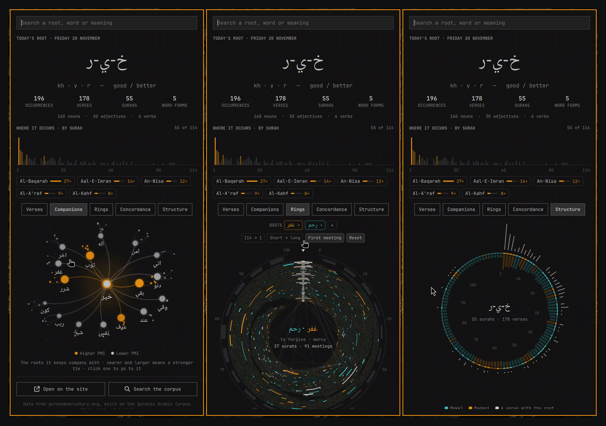
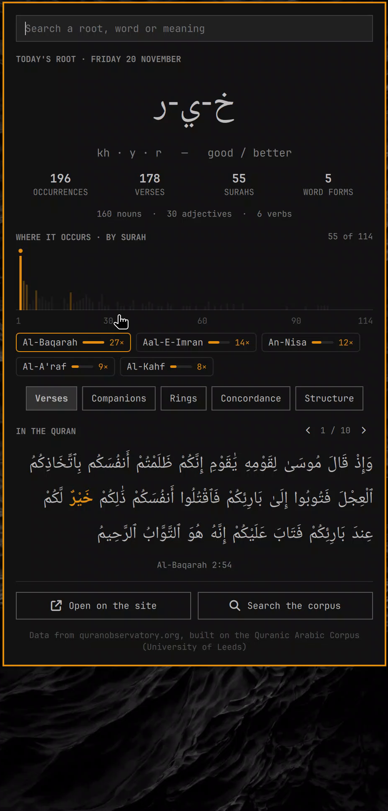
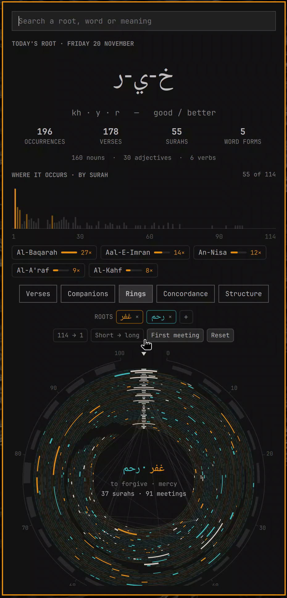
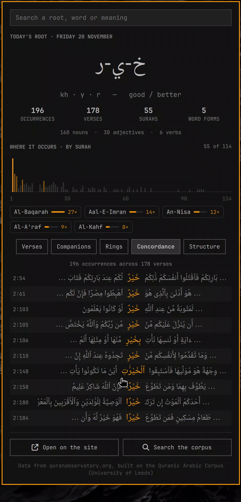
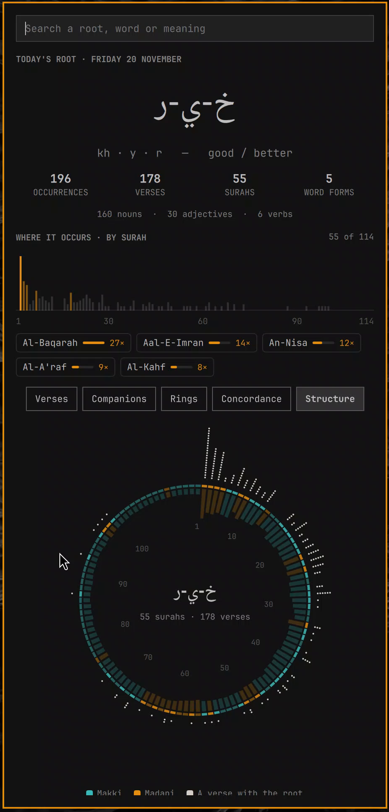

# Quran Observatory for Omarchy

Today's Quranic root in your [Omarchy](https://omarchy.org) bar, from
[quranobservatory.org](https://www.quranobservatory.org).




It sits in a faint, softly rounded frame so it doesn't blend into the
clock and indicators beside it (or set *Bar style* to *Plain*). Click it for
the root in full: its Arabic form, transliteration and meaning; occurrences,
verses, sūrahs and word forms; the parts of speech it takes.

The graphs follow the ones on quranobservatory.org. **Where it occurs · by
sūrah** is always there: the site's strip of 114 bars, the busier sūrahs in
the accent, with the sūrahs it occurs in most as chips underneath; the sūrah
of the verse on show is spotlighted. Under that, one view at a time:

- **Verses**: example verses with the root's words highlighted
- **Companions**: the site's collocation burst. The root glows in the
  middle; curved strands run to the sixteen roots it keeps company with,
  nearer, larger and in the accent for a stronger tie (higher PMI), each
  trailing tendril dots. They're chosen by local mutual information (shared
  verses × PMI), so the commonest roots don't crowd out the telling ones:
  ر-ح-م's companions include غ-ف-ر (forgive), ت-و-ب (repent), ف-ض-ل (bounty).
  Click a companion to move to it.
- **Rings**: the site's concordance rings. Every sūrah is a ring (114 at
  the centre, 1 outermost), every verse a tick, taller for longer verses,
  lit where the chosen roots occur and cream where they all meet; threads
  join meetings on neighbouring rings, and a histogram round the outside
  shows where in their sūrahs the meetings fall. Up to three roots, each
  picked by search (the root on show and its strongest companion to
  start). The rings move as on the site: re-order them (114 → 1, short →
  long, by first meeting) and they travel to their new places; **Align**
  turns every ring until its first meeting sits under the marker at 12
  o'clock. Hover a verse to read it.
- **Concordance**: every occurrence in context, with the word centred
  between what comes before and after it, and its verse reference
- **Structure**: the site's Quran structure map. The 114 sūrahs round a
  clock face, tinted Makki or Madani, each with an inward bar for its
  length and a stack of dots outward, one per verse holding the root; hover
  a sūrah for its name and counts. Under it, the Makkan / Madinan split,
  marked against where an even spread would fall.

| Verses | Rings | Concordance | Structure |
| --- | --- | --- | --- |
|  |  |  |  |

Search by Arabic root or word (`رحمة`, `يكتبون`, `أم القرى`), English meaning
(`mercy`), Buckwalter (`rHm`) or transliteration (`r h m`).

Today's root is the same one the site's homepage shows. The plugin picks it
with the site's own formula, so the two change together at local midnight.

## Privacy and network use

The widget downloads four public files from quranobservatory.org (the
root index, the word-form index, and the concordance with its text, about
3.5 MB together) and keeps them in
`~/.cache/io.github.lavart.quran-observatory/`. Today's root, the search and
every diagram run on that copy: **the widget itself never sends what you type
or the roots you look at anywhere**. Only the explicit actions under *Site
links* hand anything to the website.

- **Update schedule:** downloads are weekly by default. The *Download root
  data* setting switches them to daily, or *Off* to stop them altogether:
  the widget then makes no network requests of its own.
- **Safe downloads:** a download replaces the cache only after it parses
  and validates, so a dropped connection never costs you the copy that
  works. Every field is length- and range-checked, and all text is drawn as
  plain text.
- **Site links:** four actions, each one you take on purpose, open
  quranobservatory.org in your browser, which then fetches the page as any
  link would: **Ctrl+Enter** in the search (the URL carries what you typed),
  the **Search the corpus** button (the same, or the root on show), **Open on
  the site** (the root on show), and a **right click on the bar widget**
  (today's root). Plain Enter never does: it picks a result or does nothing.
  These work whatever the download setting.

## Install

```
omarchy plugin add https://github.com/lAvArt/quran-observatory --enable
```

To remove it: `omarchy plugin remove io.github.lavart.quran-observatory`, and
delete `~/.cache/io.github.lavart.quran-observatory/` for the downloaded data.

Or copy the plugin files into
`~/.config/omarchy/plugins/io.github.lavart.quran-observatory/`, then
run `omarchy-shell shell rescanPlugins` and
`omarchy bar put io.github.lavart.quran-observatory --section centerEnd`.

## Use

| | |
|---|---|
| Left click | open the panel |
| Right click | open today's root on quranobservatory.org |
| Type | search |
| Up / Down, Enter | choose a result |
| Escape | clear the search, go back to today's root, then close |
| Up / Down (search empty) | switch the view |
| Left / Right (search empty) | step through the example verses |
| Page Up / Page Down | scroll the concordance |
| Ctrl+Enter | open this search on quranobservatory.org in your browser (sends the search text) |
| Tab | next panel |

## Settings

| Setting | Options |
|---|---|
| Bar label | Root and meaning · Root · Transliteration and meaning · Icon only |
| Bar style | Chip · Plain |
| Show occurrences | On · Off (the `196×` after the root) |
| Download root data | Weekly · Daily · Off |
| Arabic font | any installed font; default Noto Naskh Arabic |

The interface is in English and Arabic and follows Omarchy's language
setting. In Arabic, the site links open the Arabic version of the site.

## Scripting

```
qs ipc call io.github.lavart.quran-observatory today       # خ-ي-ر (kh · y · r) - good / better - 196 occurrences
qs ipc call io.github.lavart.quran-observatory search رحمة  # open the panel on a search
qs ipc call io.github.lavart.quran-observatory toggle
qs ipc call io.github.lavart.quran-observatory view companions   # or verses, rings, concordance, structure
qs ipc call io.github.lavart.quran-observatory showRoot mercy     # open on a root
qs ipc call io.github.lavart.quran-observatory ringsRoots "غفر رحم"   # the rings' roots
qs ipc call io.github.lavart.quran-observatory rings first true   # order (mushaf | length | first), align
qs ipc call io.github.lavart.quran-observatory refresh     # download the data now
```

To bind a key, for example in `~/.config/hypr/bindings.lua`:
`qs ipc call io.github.lavart.quran-observatory toggle`.

## Development

```
node test/model-test.js
node test/reference-test.mjs <site-repo> root-stats.json form-index.json concordance.json concordance-text.json
```

`model-test.js` needs nothing but node. `reference-test.mjs` runs the site's
own TypeScript next to the plugin's port and checks that they agree: today's
root over 1,000 days, the root lookup over 55 queries, the word-form lookup
over a sample of the corpus's surface forms, and, for every root, its
per-sūrah verse counts and the revelation places against the site's
concordance code. The data files are at
`https://www.quranobservatory.org/data/`.

After editing an installed copy, run `omarchy restart shell`. The running
shell doesn't always reload a plugin it has already loaded.

## Data

The root data is built by quranobservatory.org from the
[Quranic Arabic Corpus](https://corpus.quran.com) (University of Leeds).
Nothing from the corpus is bundled here; it's downloaded at run time.

## License

MIT, see [LICENSE](LICENSE) and [NOTICE.md](NOTICE.md).
